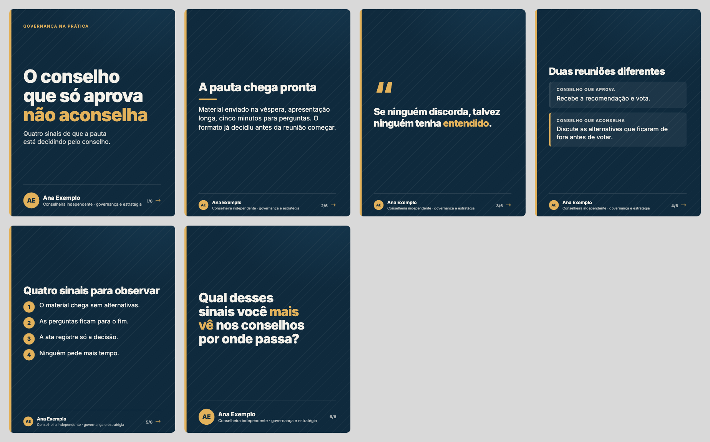

# Assistente de posicionamento

**Do que você vive e pensa ao post, artigo e carrossel no LinkedIn, com a sua voz.**

Uma skill para o Claude (Claude Code e app do Claude no computador), em português, para executivos, conselheiros e
profissionais que querem ser lembrados por algo. Ela não fabrica posts: ajuda você a sair de uma **experiência** para
uma **ideia**, escolher a **intenção**, escrever com a **sua voz**, sem cara de IA, e aprender com os números.

<p align="center">
  <br>
  <br>
  <sub>Capa de artigo e carrossel de uma persona fictícia. As cores, a fonte e a foto vêm do seu perfil.</sub>
</p>

## O que ela faz
- **Configuração guiada (uma vez):** quem você é, pelo que quer ser lembrado, para quem escreve, três linhas
  editoriais mais uma de teste, sua voz medida a partir de textos seus, e o visual (cores tiradas do seu logo ou banner).
- **Entrevista antes de escrever.** Começa pelo que você viveu, sabe, observa e pensa. Só escreve quando existe uma
  ideia em uma frase: o que alguém deve levar daqui. Assunto não é ideia.
- **Intenção antes de formato.** Ampliar alcance, compartilhar conhecimento, gerar conversa ou reforçar
  posicionamento. A intenção escolhe o formato e a métrica que vai dizer se funcionou.
- **Sua voz, medida.** O texto não pode ficar "mais sofisticado do que você fala".
- **Sem cara de IA.** Um verificador aponta o que os leitores reconhecem: "não é X, é Y" em série, frases paralelas
  ("Planos mostram… Recursos mostram…"), clichês, transições mecânicas, emojis como marcadores, fecho "e você, o que acha?".
- **Regras de autoria.** Nenhuma opinião que você não deu, nenhuma experiência inventada, e um aviso quando o texto
  não tem nada seu. A skill não escreve comentários e não publica nada.
- **Post, artigo e carrossel.** Artigo com título e capa (1920×1080); carrossel em PDF (1080×1350) pronto para subir.
- **Memória.** Você exporta a planilha de análises do LinkedIn e a skill lê sozinha: acha cada post, compara o
  resultado com a intenção e guarda o que você aprendeu. Ela nunca entra na sua conta.
- **Sigilo para conselheiros e administradores.** Alerta sobre deliberações, informação ainda não pública e casos que
  deixem deduzir a empresa. Para médicos, há também um módulo com as regras de publicidade do CFM.

## Para não ficar igual a todo mundo
Se mil pessoas usarem a mesma skill, o risco é tudo sair com a mesma cara. Por isso:
- **Detalhe que só você sabe, obrigatório.** Todo conteúdo precisa de um: um lugar, um número da sua experiência, uma
  frase que alguém disse, a decisão que você tomou. Sem ele, a skill não escreve.
- **Onze estruturas de post** (cena, número, confissão, contraintuitivo, carta, diálogo, bastidor…), escolhidas pela
  ideia e sem repetir as dos seus últimos posts. Nem todo post termina em pergunta.
- **Suas expressões, literalmente.** A voz guarda as expressões que você realmente usa, não uma descrição genérica.
- **A skill vigia os próprios cacoetes**, não só os clássicos de IA, e avisa quando você repete trechos ou aberturas
  dos seus posts anteriores.
- **Cinco famílias de layout**, seis fontes, seu logo, sua foto e variações que saem do seu nome. Nenhuma paleta
  padrão: ou as cores da sua marca, ou uma escolhida por você.

<p align="center"></p>

## Veja um caso real
[`exemplo/`](exemplo/) mostra um artigo escrito com IA e já editado pelo autor, que ainda tinha cara de IA: o que o
verificador apontou e a versão final na voz dele.

## Instalar
Passo a passo para quem não é técnico: [docs/INSTALAR.md](docs/INSTALAR.md). Recebeu um zip? Veja o `LEIA-ME.md` dentro dele.

Se você já usa o Claude Code no terminal:
```
/plugin marketplace add Gomes287/assistente-de-posicionamento
/plugin install assistente-de-posicionamento@assistente-de-posicionamento
```
Depois, diga ao Claude: *"configurar meu assistente de posicionamento"*.

Requisitos: app do Claude ou Claude Code, Python 3.9+ e Google Chrome (ou Edge, Brave, Chromium).
Seus dados ficam só no seu computador, em `~/.config/assistente-de-posicionamento/`.

## As três skills
| skill | quando |
|---|---|
| `linkedin-config` | uma vez: perfil, posicionamento, linhas editoriais, voz, visual |
| `linkedin-post` | "post sobre…", "artigo sobre…", "não sei o que postar", "trouxe a planilha do LinkedIn" |
| `linkedin-carrossel` | "carrossel sobre…", "transforma esse artigo em carrossel" |

## Limites
- Este projeto não tem ligação com o LinkedIn.
- Os módulos de sigilo e do CFM são checagens de apoio, não parecer jurídico.
- Testado no Mac. Windows e Linux ainda não foram testados a fundo.

Código: MIT, © 2026 Pedro Gomes. Fontes: SIL Open Font License 1.1. O conteúdo de `exemplo/` é de Pedro Gomes,
mostrado com autorização, e não faz parte da licença MIT.
